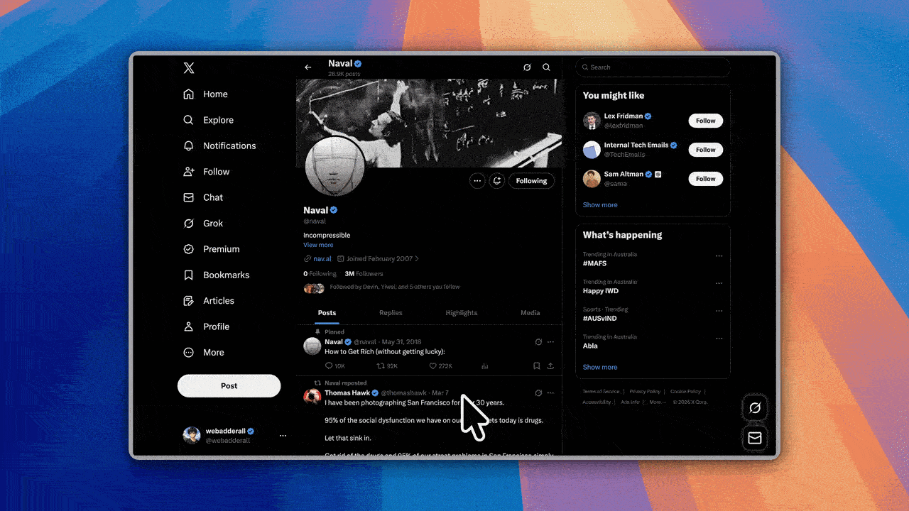
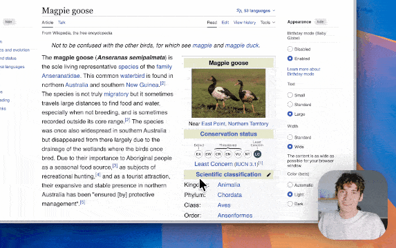

Ngôn ngữ: [English](README.md) | Tiếng Việt | [简体中文](README.zh-CN.md)

<p align="center">
  
</p>

<p align="center">
  
  
</p>

### Tạo video hướng dẫn chỉn chu trong vài phút
[Recordly](https://www.recordly.dev) là trình **ghi và chỉnh sửa màn hình mã nguồn mở**, phù hợp để tạo **video hướng dẫn, bản demo, video sản phẩm** và nhiều nội dung khác.
**Chào đón các đóng góp qua PR.**


---
### Được cộng đồng đồng hành
<a href="https://coderabbit.link/recordly"></a>

---

## Recordly là gì?

Recordly là ứng dụng máy tính để ghi và chỉnh sửa màn hình, tích hợp các công cụ trình bày sinh động cho video hướng dẫn. Thay vì cần người dựng phim thêm hiệu ứng thu phóng, trau chuốt con trỏ hoặc thiết kế nền cho video thô, bạn có thể thực hiện tất cả trong Recordly, miễn phí và tại một nơi.

Recordly hỗ trợ:

- **macOS** 14.0 trở lên
- **Windows** 10 Build 19041 trở lên
- **Linux** trên các bản phân phối hiện đại

Thông tin theo nền tảng:

- **macOS** sử dụng các thành phần ghi hình gốc dựa trên ScreenCaptureKit.
- **Windows** sử dụng thành phần Windows Graphics Capture (WGC) gốc trên các phiên bản được hỗ trợ, cùng khả năng thu âm WASAPI gốc.
- **Linux** ghi hình qua API ghi hình của Electron. Hiện chưa hỗ trợ ẩn con trỏ trên Linux.

---

# Tính năng chính

## Tự động thu phóng, trau chuốt con trỏ và tạo khung hình đẹp
Recordly có thể tự đề xuất các điểm cần nhấn mạnh bằng hiệu ứng thu phóng, làm mượt chuyển động con trỏ, thêm hiệu ứng chuyển động và đặt video vào khung hình được thiết kế với hình nền, màu đơn sắc, chuyển màu, làm mờ, khoảng đệm và bóng đổ.

<p>
  
</p>

## Lớp phủ webcam dạng bong bóng động
Thêm video webcam dưới dạng bong bóng lớp phủ, đặt bằng vị trí thiết lập sẵn hoặc tọa độ tùy chỉnh, lật hình và điều chỉnh bóng đổ cũng như độ bo tròn. Bạn cũng có thể để webcam tự thay đổi theo hiệu ứng thu phóng, giúp bố cục hài hòa trong lúc chuyển động.

<p>
  
</p>

## Chỉnh sửa dòng thời gian dành cho video hướng dẫn
Dùng các công cụ kéo thả trên dòng thời gian để chỉnh vùng thu phóng, cắt, thay đổi tốc độ, thêm chú thích, thêm vùng âm thanh và cắt khung hình. Lưu công việc thành tệp dự án `.recordly` để tiếp tục chỉnh sửa sau.

<p>
  
</p>

## Tiện ích mở rộng và chợ tiện ích

Recordly có hệ thống tiện ích mở rộng do cộng đồng phát triển. Mọi người đều có thể tạo và phát hành tiện ích để bổ sung chức năng như âm thanh khi nhấp chuột, khung thiết bị, giao diện trình duyệt, hình nền, hook kết xuất và bảng cài đặt.

Khám phá và cài đặt tiện ích cộng đồng tại [Chợ tiện ích Recordly](https://marketplace.recordly.dev/extensions).

---

## Tất cả tính năng

### Ghi hình

- Ghi toàn bộ màn hình hoặc một cửa sổ ứng dụng
- Mở trình chỉnh sửa ngay sau khi ghi
- Thu âm thanh từ micrô và hệ thống
- Dùng bộ ghi hình gốc trên các nền tảng được hỗ trợ
- Tiếp tục chỉnh sửa từ các tệp dự án `.recordly` đã lưu
- Mở bản ghi hoặc tệp dự án có sẵn ngay trong ứng dụng

### Dòng thời gian và chỉnh sửa

- Chỉnh sửa dòng thời gian bằng thao tác kéo thả
- Cắt bỏ các đoạn không mong muốn
- Thêm vùng thu phóng thủ công
- Nhận đề xuất thu phóng tự động dựa trên hoạt động của con trỏ
- Thêm các vùng tăng hoặc giảm tốc độ
- Thêm chú thích dạng văn bản, hình ảnh và hình khối
- Thêm các vùng âm thanh trên dòng thời gian
- Cắt khung hình đã ghi
- Lưu và mở lại dự án mà vẫn giữ nguyên trạng thái chỉnh sửa

### Điều khiển con trỏ

- Hiện hoặc ẩn lớp phủ con trỏ được kết xuất
- Điều chỉnh kích thước con trỏ
- Làm mượt chuyển động con trỏ
- Làm mờ chuyển động con trỏ
- Tạo hiệu ứng con trỏ nảy khi nhấp
- Tạo chuyển động lắc nhẹ cho con trỏ
- Chế độ lặp con trỏ giúp video xuất lặp tự nhiên hơn
- Tài nguyên con trỏ kiểu macOS cho lớp phủ được kết xuất

### Lớp phủ webcam

- Bật hoặc tắt video webcam phủ lên bản ghi
- Tải lên, thay thế hoặc gỡ video webcam
- Lật gương hình webcam
- Điều chỉnh kích thước
- Chọn vị trí thiết lập sẵn hoặc đặt tọa độ X/Y tùy chỉnh
- Điều chỉnh lề
- Điều chỉnh độ bo tròn
- Điều chỉnh bóng đổ
- Tùy chọn để webcam thay đổi kích thước theo hiệu ứng thu phóng

### Tạo kiểu khung hình và hình nền

- Hình nền tích hợp
- Tự động tìm hình nền trong thư mục wallpapers khi chạy
- Tải ảnh nền tùy chỉnh lên
- Nền màu đơn sắc
- Nền chuyển màu
- Khoảng đệm trong khung hình
- Bo góc
- Làm mờ nền
- Bóng đổ
- Thiết lập sẵn tỷ lệ khung hình đầu ra

### Xuất

- Xuất video MP4
- Xuất ảnh động GIF
- Chọn chất lượng xuất
- Chọn tốc độ khung hình GIF
- Bật/tắt chế độ lặp GIF
- Chọn kích thước GIF thiết lập sẵn
- Điều chỉnh tỷ lệ khung hình và kích thước đầu ra
- Mở thư mục chứa tệp đã xuất trong trình quản lý tệp

### Quy trình làm việc và tính dễ sử dụng

- Tùy chỉnh phím tắt
- Tra cứu phím tắt ngay trong ứng dụng
- Mở liên kết phản hồi và báo lỗi từ trình chỉnh sửa
- Lưu các tùy chọn của trình chỉnh sửa
- Khôi phục bản xem trước nhanh hơn sau khi xuất

---

# Ảnh chụp màn hình

<p align="center">
  
</p>

<p align="center">
  
</p>

<p align="center">
  
</p>

---

# Cài đặt

## Tải bản dựng

Các bản phát hành dựng sẵn có tại:

https://github.com/webadderallorg/Recordly/releases

---

## Arch Linux / Manjaro (yay)

Cài đặt từ AUR ([recordly-bin](https://aur.archlinux.org/packages/recordly-bin)):

```bash
yay -S recordly-bin
```

PKGBUILD, mục ứng dụng trên máy tính, đồng bộ bản phát hành và tùy chọn **đóng gói cục bộ từ mã nguồn** được quản lý trong **[recordly-aur](https://github.com/firtoz/recordly-aur)** để kho mã này không phải xử lý các công việc phát hành riêng cho Arch. Để liên hệ người duy trì hoặc tìm hiểu cách cập nhật gói, xem kho đó hoặc trang gói AUR.

---

## Tự dựng từ mã nguồn

### Yêu cầu trước khi bắt đầu

**macOS:** Xcode Command Line Tools (`xcode-select --install`).

**Linux (Ubuntu/Debian):**

```bash
sudo apt install build-essential cmake libx11-dev libxtst-dev libxrandr-dev libxt-dev
```

**Windows:** Visual Studio 2022 (hoặc Build Tools) có workload C++ và CMake.

### Các bước

```bash
git clone https://github.com/webadderallorg/Recordly.git recordly
cd recordly
npm install
npm run dev
```

Để đóng gói ứng dụng:

```bash
npm run build
```

Cũng có các lệnh dựng riêng cho từng nền tảng:

- `npm run build:mac`
- `npm run build:win`
- `npm run build:linux`

---

## macOS: “Không thể mở ứng dụng”

macOS có thể cách ly ứng dụng được dựng cục bộ.

Bỏ cờ cách ly bằng lệnh:

```bash
xattr -rd com.apple.quarantine /Applications/Recordly.app
```

---

# Yêu cầu hệ thống

| Nền tảng | Phiên bản tối thiểu | Ghi chú |
|---|---|---|
| **macOS** | macOS 14.0 (Sonoma) | Cần thiết để thu âm thanh hệ thống và micrô bằng ScreenCaptureKit. |
| **Windows** | Windows 10 20H1 (Build 19041, tháng 5 năm 2020) | Cần thiết cho thành phần Windows Graphics Capture (WGC) gốc và khả năng ẩn con trỏ tốt nhất. |
| **Linux** | Bất kỳ bản phân phối hiện đại nào | Ghi hình qua Electron. Âm thanh hệ thống thường cần PipeWire. |

> [!IMPORTANT]
> Trên Windows cũ hơn Build 19041, vẫn có thể ghi hình bằng chế độ dự phòng, nhưng con trỏ thật của hệ điều hành có thể vẫn xuất hiện trong bản ghi.

---

# Cách sử dụng

## Ghi hình

1. Mở Recordly.
2. Chọn màn hình hoặc cửa sổ.
3. Chọn tùy chọn micrô và âm thanh hệ thống.
4. Bắt đầu ghi.
5. Dừng ghi để mở trình chỉnh sửa.

## Chỉnh sửa

Trong trình chỉnh sửa, bạn có thể:

- thêm đoạn cắt, vùng thu phóng, vùng thay đổi tốc độ và chú thích
- điều chỉnh hoạt động của con trỏ và âm lượng xem trước
- tạo kiểu khung hình bằng hình nền, màu, chuyển màu, làm mờ, khoảng đệm và bo góc
- thêm hoặc điều chỉnh video webcam phủ lên bản ghi
- thêm các vùng âm thanh
- cắt khung hình và chọn tỷ lệ khung hình

Bạn có thể lưu công việc bất cứ lúc nào thành dự án `.recordly`.

## Xuất

Các tùy chọn xuất bao gồm:

- **MP4** cho video thông thường
- **GIF** để chia sẻ nhẹ và tạo ảnh động lặp

Trước khi xuất, bạn có thể điều chỉnh các cài đặt theo định dạng như chất lượng, tốc độ khung hình GIF, chế độ lặp GIF và kích thước đầu ra.

---

# Giới hạn

### Ghi con trỏ

Recordly kết xuất lớp phủ con trỏ đã được trau chuốt lên bản ghi. Khả năng ẩn con trỏ của nền tảng còn tùy thuộc vào hỗ trợ của hệ điều hành.

**macOS**
- ScreenCaptureKit có thể loại bỏ con trỏ thật một cách gọn gàng.

**Windows**
- Để có kết quả tốt nhất, cần Windows 10 Build 19041 trở lên và thành phần ghi hình gốc.
- Các bản dựng cũ hơn dùng chế độ ghi hình dự phòng của Electron nên con trỏ thật có thể vẫn hiển thị.

**Linux**
- Tính năng ghi màn hình của Electron hiện chưa hỗ trợ ẩn con trỏ.
- Nếu bật thêm lớp phủ con trỏ được kết xuất, video xuất ra có thể hiển thị cả con trỏ thật lẫn con trỏ đã tạo kiểu.

### Âm thanh hệ thống

Khả năng thu âm thanh hệ thống tùy thuộc vào nền tảng.

**Windows**
- Hỗ trợ WASAPI gốc.

**Linux**
- Thường cần PipeWire.

**macOS**
- Cần macOS 14.0 trở lên và quy trình dựa trên ScreenCaptureKit.

---

# Cách hoạt động

Recordly kết hợp lớp ghi hình riêng cho từng nền tảng với trình chỉnh sửa và quy trình xuất dựa trên bộ kết xuất.

**Ghi hình**
- Electron điều phối việc ghi hình và luồng hoạt động của ứng dụng.
- macOS dùng các thành phần ScreenCaptureKit gốc.
- Windows dùng thành phần Windows Graphics Capture (WGC) gốc và các thành phần âm thanh gốc khi có hỗ trợ.

**Chỉnh sửa**
- Các vùng trên dòng thời gian xác định hiệu ứng thu phóng, đoạn cắt, thay đổi tốc độ, lớp phủ âm thanh và chú thích.
- Kiểu con trỏ và webcam được áp dụng theo trạng thái chỉnh sửa.

**Kết xuất**
- Bố cục cảnh được xử lý bằng **PixiJS**.

**Xuất**
- Cùng logic dựng cảnh dùng cho bản xem trước được sử dụng để kết xuất video MP4 hoặc GIF.

**Dự án**
- Tệp `.recordly` lưu đường dẫn đến phương tiện nguồn cùng trạng thái chỉnh sửa để có thể mở lại sau.

---

# Đóng góp

Chúng tôi hoan nghênh mọi đóng góp.

Những lĩnh vực đặc biệt cần hỗ trợ:

- Ghi hình và xử lý con trỏ trên Linux
- Hiệu năng và độ ổn định khi xuất
- Cải thiện giao diện và trải nghiệm người dùng
- Bản địa hóa
- Công cụ chỉnh sửa và cải thiện quy trình làm việc

Vui lòng giữ phạm vi pull request tập trung, kiểm tra quy trình ghi/chỉnh sửa/xuất và tránh tái cấu trúc không liên quan.

Xem hướng dẫn tại `CONTRIBUTING.md`.

---

# Cộng đồng

Báo lỗi và đề xuất tính năng:

https://github.com/webadderallorg/Recordly/issues

Chào đón các pull request.

---

# Những người ủng hộ

[](https://ko-fi.com/webadderall)

- Tom Egan @tomegan trên X
- Robin Ebers @robinebers trên X
- Tadees
- buildwithfur
- piccinato
- Tobias
- Người ủng hộ ẩn danh
- Tandava Appadoo
- Digitalfastmind
- Roberto Marcelino
- Tony
- Rajan RK
- Francesco
- Erwan
- Người ủng hộ ẩn danh

---

# Giấy phép

Recordly được cấp phép theo **AGPL 3.0**.

---

# Ghi công

## Lời cảm ơn

Recordly ban đầu là một nhánh của [OpenScreen](https://github.com/siddharthvaddem/openscreen). Hơn 80% mã nguồn đã thay đổi kể từ đó. Nhiều tính năng của OpenScreen, chẳng hạn như hiệu ứng thu phóng, được chuyển trực tiếp từ các phiên bản đầu của Recordly.

Được tạo bởi  
[@webadderall](https://x.com/webadderall)

---
