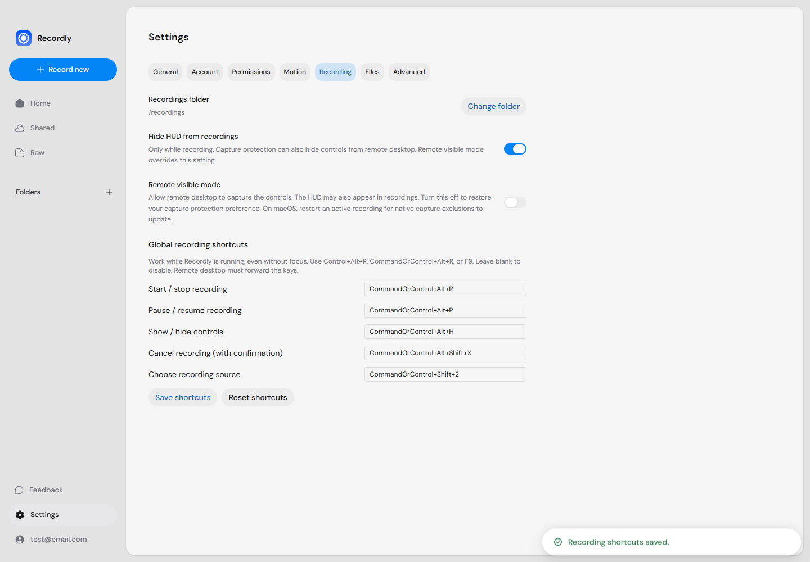

# Recording over remote desktop

Recordly's capture protection can hide the recording HUD from a remote desktop
client as well as from Recordly's own recording. A hidden HUD does not mean that
capture has stopped. This also depends on the remote client's capture method.

## Make controls visible remotely

Open **Home → Settings → Recording → Remote visible mode** on the computer running
Recordly. This setting persists across restarts and disables HUD capture protection.
**The HUD may appear in the recorded video.** Turning remote visible mode off restores
your previous **Hide HUD from recordings** preference. It does not move or resize the HUD.
Use the show/hide shortcut below to restore controls you previously minimized or hid.

On macOS, native capture process exclusions are chosen when a recording starts.
Restart an active recording after changing the mode to update those exclusions.
Actual visibility still needs to be checked with your remote desktop client.

## Control recording without focusing Recordly

Recordly must be running and its capture HUD loaded. Choose a recording source
before starting. Normal sign-in and capture permission requirements still apply.

| Action | Windows / Linux default | macOS default |
| --- | --- | --- |
| Choose recording source | Ctrl+Shift+2 | Cmd+Shift+2 |
| Start / stop recording | Ctrl+Alt+R | Cmd+Option+R |
| Pause / resume | Ctrl+Alt+P | Cmd+Option+P |
| Show / hide HUD | Ctrl+Alt+H | Cmd+Option+H |
| Cancel and discard, with confirmation | Ctrl+Alt+Shift+X | Cmd+Option+Shift+X |

The source shortcut restores the HUD and opens the same picker as its source
button. It selects only; use Start / stop afterward to record. It is ignored while
recording, counting down, or finalizing. Windows selects a screen or window;
macOS also supports area selection. Linux uses its existing source-list/portal flow.
It does not add a screenshot/GIF/MP4 selection toolbar.

Showing the HUD does not disable capture protection. Enable remote visible mode if
the HUD is still absent from the remote stream. Pause/resume is ignored while idle;
commands are ignored during countdown and finalization. Cancel asks for confirmation
in a native dialog outside the protected HUD, with **Keep recording** as the default.

Edit bindings in **Home → Settings → Recording → Global recording shortcuts**.
Use Electron accelerators such as `Control+Alt+R`, `CommandOrControl+Alt+R`, or `F9`.
Leave an entry blank to disable it. Save applies and persists changes immediately;
Reset restores defaults. Invalid or duplicate entries are rejected. OS registration
failures are shown in this panel and logged; an unavailable binding is inactive.
Settings live in `recording-shortcuts.json` inside Electron's user data directory.

UU Remote or another remote desktop client must forward the chosen combination
to the controlled computer. Some combinations may be reserved by the client, host
OS, or another application. Try a different binding when necessary. Fullscreen
applications and secure desktops may intercept input; global shortcuts cannot
guarantee delivery in those environments. Linux Wayland also depends on desktop
portal support and consent.

## Verification

Automated checks cover configuration validation, OS registration failure reporting,
persistence, cleanup, hidden-HUD command routing, confirmation safety, remote mode
preference restoration, and renderer callbacks. Browser tests use a desktop bridge
and mocked native capture; they do not prove OS hotkey delivery or real media output.

Before marking this fix as verified for UU Remote on Windows:

1. Run the changed application on Windows and connect from the remote computer.
2. With capture protection enabled, select a source and start a recording.
3. Focus another application. Pause, resume, stop, and replay the saved file.
4. Start another take; cancel once with **Keep recording**, then confirm discarding.
5. Enable remote visible mode. Confirm the HUD is visible through UU, including
   during capture, and inspect whether it appears in the saved video.
6. Hide/restore the HUD, relaunch, and verify settings persist. Disable remote mode
   and confirm the original capture protection preference returns.
7. Occupy a binding in another application, relaunch Recordly, and confirm Settings
   reports the failed binding. Rebind it and verify the new combination works.

Related upstream work: [HUD remote visibility report #693](https://github.com/webadderallorg/Recordly/issues/693)
(macOS report), and [global recording shortcuts PR #956](https://github.com/webadderallorg/Recordly/pull/956).
The latter overlaps the shortcut work; this change also covers persistent remote
visibility, show/hide, and confirmed discard. It does not claim that #693 establishes
the cause of every Windows remote capture issue.
